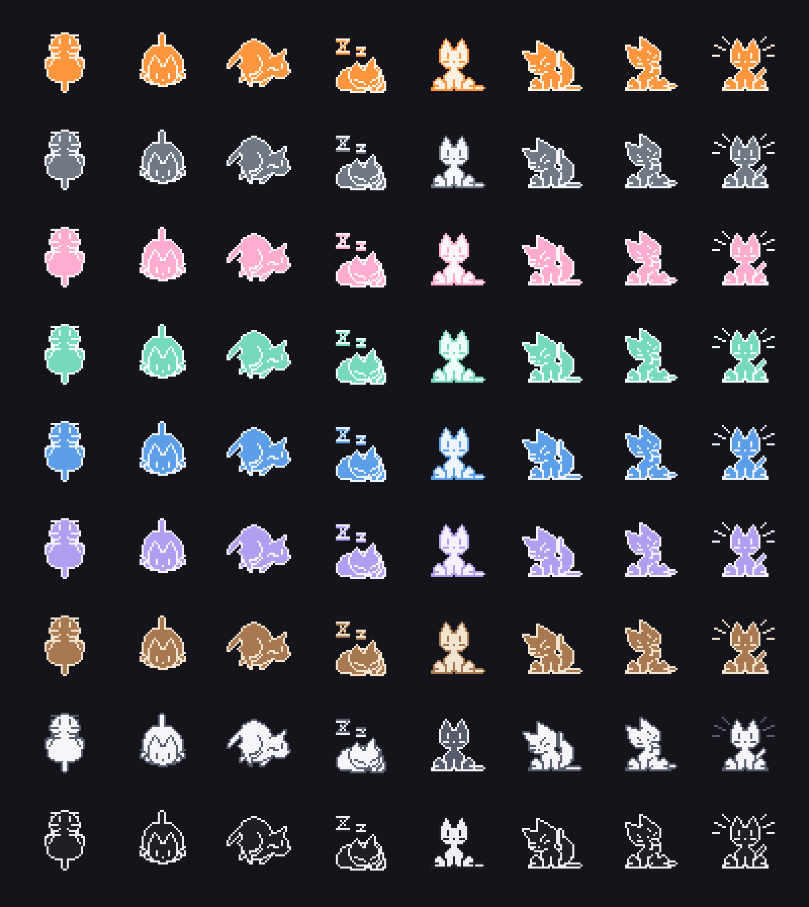

# Gneko

A pixel cat that lives on your Windows desktop. It wanders, plays with you, chases your cursor — and if you pick it up and fling it, it flies.

Based on Linux Oneko (the 1990 X11 desktop cat), rewritten with tkinter + Win32 APIs.

[简体中文](README.md) | **English**


## Features

- **True transparency**：Win32 layered window + color key (`#ff00ff`) — no white boxes, and transparent areas are click-through
- **Crisp pixels**：integer nearest-neighbour upscaling + per-process DPI awareness; switch between 1x–6x at any time
- **8-direction walking**：reuses `upleft / upright / dwleft / dwright` sprites so diagonal movement looks natural
- **Adaptive frame rate**：~24 ms per frame while walking, 55 ms while idling or sleeping
- **Chases you**：the further away you are, the faster it runs (up to 2.6×); it "catches" you within 16 px of the cursor and celebrates. Flicking the mouse quickly excites it more; it only loses interest when you really stop moving
- **Fling**：grab it and flick — it flies with inertia, bounces off screen edges, and is briefly stunned on landing
- **Multi-cat networking**：UDP position broadcast — run two instances and they chase each other; a closed instance is forgotten after 2.5 s
- **Stays out of your way**：click-through mode (`Ctrl+Alt+G` toggles it)
- **Tunable**：40+ behaviour parameters in `Gneko_config.json`
- **9 preset skins**：orange, gray, pink, mint, sky, lavender, coffee, snow, ink — switch from the right-click menu

## Skins

Every folder under `skins/` is a complete sprite pack (recoloured frames + `mouse.png`) using exactly the same file-name rules as `Gneko_png`.

| Name | Look | Name | Look |
| --- | --- | --- | --- |
| `orange` | orange tabby tint | `lavender` | lavender |
| `gray` | silver gray | `coffee` | coffee brown |
| `pink` | pink | `snow` | snow white |
| `mint` | mint green | `black` | ink black |
| `sky` | sky blue | `classic` | original B&W (`Gneko_png`) |



Three ways to switch:

1. **Right-click → 皮肤 (Skins)**, pick one — applied instantly and written back to the config
2. Set `"SKIN": "orange"` in `Gneko_config.json` and restart
3. Try it from the CLI: `py -3 Gneko.py --skin snow`

`SKIN` set to `classic` (or empty) uses `SPRITE_FOLDER` (default `Gneko_png`). Any other value looks for `SKINS_DIR/skins/<name>/`; a missing or empty folder falls back to `classic` with a warning.

### Making your own skin

The original pixel art uses just two colours — **solid black body + white rim**, so a skin is basically a two-colour swap.

```bash
# 1. add an entry to the SKINS dict in tools/make_skins.py: (label, body, rim)
# 2. regenerate all skins
py -3 tools/make_skins.py
```

Or copy `skins/orange` to a new folder and repaint the PNGs by hand. Keep the naming pattern (`up1`, `dwleft2`, `sleep1`, `utogi`, …) and they will be picked up; the minimum viable skin is `right1`/`right2` plus one `awake` frame — anything missing falls back automatically.

## Download

Prefer not to set up Python? Grab the packaged files from the [Releases](https://github.com/yizhixiaomei/Gneko/releases) page:

- `Gneko-vX.Y.Z-windows-x64.exe` — **standalone single-file build**, no Python needed (about 20 MB); just double-click
- `Gneko-vX.Y.Z-source.zip` — full source, sprites and all nine skins
- `Gneko-cursor-pack.zip` — the Windows pixel-cat cursor pack (`.cur` / `.ani` plus a one-click installer)
- `SHA256SUMS.txt` — SHA256 digests for all three archives

To confirm you really got the original build, hash the file after downloading and compare it with the table in the release notes (or `SHA256SUMS.txt`):

```powershell
Get-FileHash ".\Gneko-vX.Y.Z-windows-x64.exe" -Algorithm SHA256
```

On first launch the exe writes `Gneko_config.json` and `Gneko.log` **next to itself**. Right-click menu, skin switching and CLI flags all behave exactly like the source version.

## Requirements

Running from source needs:

- Windows 10 / 11 (relies on Win32 layered windows and system cursor APIs)
- Python 3.9+ with tkinter
- [Pillow](https://python-pillow.org/) (the only third-party dependency)

The prebuilt exe from Releases needs nothing installed — any 64-bit Windows 10/11 will do.

## Quick start

```bash
git clone <this-repo> gneko
cd gneko
pip install -r requirements.txt
```

Double-click `Gneko.py`, or:

```bash
pyw -3 Gneko.py          # no console (recommended for daily use)
py -3 Gneko.py           # with console, easier for debugging
```

`Gneko_config.json` is generated on first launch, and the log goes to `Gneko.log` (`pythonw` has no console, so all exceptions land there). Both files are already listed in `.gitignore`.

### English source

`Gneko_en.py` is a fully English copy of the same code: **comments, docstrings, log output, right-click menu, speech lines and CLI help are all in English**, and the logic is identical to `Gneko.py` (verified node by node through the AST — the only difference is one fewer Chinese alias in the skin alias list).

```bash
py -3 Gneko_en.py             # English build
py -3 Gneko_en.py --skin snow # same CLI arguments
```

Both files share the same `Gneko_config.json` and `skins/` folder, so you can run either without them fighting. If you fork the project, translate the comments along with the Chinese file — the two stay structurally identical.

## Building the exe

To hand it to someone without Python, run this from the repository root:

```powershell
pwsh -File tools\build_exe.ps1                                    # Chinese build -> dist\Gneko.exe
pwsh -File tools\build_exe.ps1 -Entry Gneko_en.py -Name Gneko-en  # English build
```

The script first regenerates `docs/gneko.ico` from `awake.png`, then calls PyInstaller to produce a **single-file, console-free** exe (about 20 MB; the first launch takes a second or two to unpack).

Two details in the packaging logic must survive any refactor:

- Sprites (`Gneko_png/`, `skins/`) are embedded in the exe and unpacked to a temp dir at runtime, so the code looks them up through `ASSET_ROOT` (i.e. `sys._MEIPASS`);
- Config and log must land in the **user's folder**, so when frozen `APP_DIR` resolves to the directory holding `sys.executable` — otherwise settings would be written into the temp dir and vanish on exit.

## Controls

| Action | Effect |
| --- | --- |
| Left-drag | Pick it up and drop it anywhere; it may scratch at the nearest edge afterwards |
| Flick | Release faster than 900 px/s and it flies with inertia, bouncing off screen edges |
| Double-click | Spin in place for 3 seconds |
| Right-click | Menu: scale / speed / skins / follow / bubbles / click-through / sleep / come to cursor / reload sprites / quit |
| Click anywhere | Raises its "interest", so it comes over sooner |
| `Ctrl+Alt+G` | Toggle click-through |
| `Esc` | Quit |

> While click-through is on you can't click the cat itself — press `Ctrl+Alt+G` first, then right-click.

Changes are written back to `Gneko_config.json`.

## Behaviour

State machine: `idle / walk / pet / scratch / groom / sleep / play / avoid / sit_approach / sit_cursor / spin_action / flung`

Chasing has four personalities; a sub-mode sticks for 0.9–2.6 s instead of being re-rolled every frame (so its path doesn't jitter):

| Sub-mode | Behaviour |
| --- | --- |
| `chase_normal` | Charges straight at the cursor |
| `chase_follow` | Keeps 90–140 px behind |
| `chase_shy` | Backs off when too close (only right after a catch, or when tired) |
| `chase_pounce` | Accelerated pounce when interest is high |

The cat has stamina: chasing drains it, idling and sleeping restore it, and below a threshold it stops chasing.

While chasing, the system arrow cursor is swapped for oneko's original mouse icon (`Gneko_png/mouse.png`, 17×12, hotspot 8,7). It works by temporarily replacing `IDC_ARROW` via `CopyIcon` + `SetSystemCursor`, so it applies to the whole desktop without affecting I-beam cursors. The cursor is restored when the cat stops chasing, when you pick it up, or when the app exits. If it ever gets killed before restoring, run `py -3 Gneko.py --restore-cursor`.

## Configuration

Missing keys in `Gneko_config.json` are filled with defaults; unknown keys are reported and ignored at startup. Common ones:

| Key | Default | Meaning |
| --- | --- | --- |
| `SKIN` | `classic` | Skin name; `classic` = original sprites |
| `SKINS_DIR` | `skins` | Root folder for skins (relative to the program folder) |
| `SPRITE_FOLDER` | `Gneko_png` | Sprite folder used by `classic` |
| `SCALE` | `2` | Pixel upscaling factor (2 = 64×64) |
| `BASE_SPEED` | `1.4` | Base movement speed |
| `AUTO_SCALE_HIDPI` | `false` | Scale automatically from system DPI |
| `CHASE_TRIGGER_DIST` | `220` | Distance at which chasing starts |
| `CHASE_MAX_SPEED_MULT` | `2.6` | Maximum chase speed-up |
| `CHASE_CATCH_DIST` | `16` | Distance that counts as "caught" |
| `INTEREST_FLOOR` | `45` | Interest floor while the cursor is nearby |
| `FLING_MIN_SPEED` | `900` | Minimum release speed for a fling (px/s) |
| `MOUSE_CURSOR_ENABLE` | `true` | Swap in the mouse cursor while chasing |
| `CLICK_THROUGH` | `false` | Click-through mode |
| `ENABLE_MULTICAT_NET` | `true` | Multi-cat networking (UDP 58231) |

The full list lives in `DEFAULT_CONFIG` at the top of `Gneko.py`.

## Command line

```bash
py -3 Gneko.py --debug            # print state logs
py -3 Gneko.py --scale 3          # temporary 3x size
py -3 Gneko.py --skin orange      # temporarily use the orange skin
py -3 Gneko.py --list-skins       # list all available skins
py -3 Gneko.py --selftest 10      # run 10 s then exit (for troubleshooting)
py -3 Gneko.py -c other.json      # use a different config file
py -3 Gneko.py --restore-cursor   # only restore the system cursor to default
```

## Project layout

```
.
├─ Gneko.py             # all the code, single file (Chinese comments)
├─ Gneko_en.py          # English-only copy: comments, docstrings, logs and UI in English
├─ Gneko_png/           # original 33 cat frames + mouse.png cursor
├─ skins/               # 9 preset skins, each a full sprite pack
│  ├─ orange/  gray/  pink/  mint/  sky/
│  └─ lavender/ coffee/ snow/ black/
├─ README.md            # Chinese version
├─ README.en.md         # English version
├─ docs/preview.png     # README preview
├─ docs/skins_preview.png  # skin reference sheet
├─ docs/gneko.ico       # app icon for packaging (generated from awake.png)
├─ tools/make_preview.py   # builds the preview image
├─ tools/make_skins.py     # generates the preset skins from Gneko_png
├─ tools/build_exe.ps1     # one-command single-file exe build
├─ requirements.txt
└─ LICENSE
```

## Sprites

32×32 PNGs in `Gneko_png/`, grouped automatically by filename:

- `up1/up2`, `upleft1/2`, `dwleft1/2` … → walking (`1/2` are the two animation frames)
- `utogi / dtogi / ltogi / rtogi` → scratching at edges
- `kaki1/2` → grooming, `sleep1/2` → sleeping, `jare2` → playing
- `awake`, `mati2`, `mati3` → idling, `pet` → being petted
- `mouse.png` → the mouse cursor used while chasing
- Cursor-pack icons such as `text.png` / `no.png` are skipped at load time and never treated as animation frames

Drop new sprites in with the same naming scheme and use "reload sprites" from the menu. The original `mati` / `pet` frames have a white background; at load time the **edge-connected** white is flood-filled away (white inside the cat is kept), so no white box ever shows up.

## FAQ

**It occasionally shows a white box?** That means a sprite is a white-background version — automatic background removal is built in, but only pure white is handled.

**The cursor is still a mouse?** It was killed before it could restore. Run `py -3 Gneko.py --restore-cursor`.

**Another window covers it?** It stays on top via `WS_EX_LAYERED | WS_EX_TOOLWINDOW` + `SetWindowPos`; some exclusive fullscreen games override that, which is expected.

**Two cats ignore each other?** Check whether your firewall blocks UDP 58231.

## AI-Generated Code Notice

The main body of this project (`Gneko.py` and `tools/make_preview.py`) was written with AI assistance: the author supplied the requirements, constraints and debugging feedback, while the AI drafted and iterated on the code. All final code was run, tested and corrected by the author on real Windows machines.

A few clarifications:

- **Code**: AI-generated, then manually tested and patched. Every behaviour has been exercised on Windows 10/11, though untested edge cases may remain. `Gneko_en.py` is an English translation of the same code, not a separate implementation
- **Art assets**: The pixel cat sprites in `Gneko_png/` and `mouse.png` all come from the original oneko (public domain) — **not** AI-generated. The `skins/` packs are recolours of that same original pixel art produced by `tools/make_skins.py`, not AI-drawn images. See Credits for attribution
- **Docs**: This README and `README.md` were drafted by AI and reviewed before committing
- **License**: Code is MIT — free to use, modify and redistribute. Keeping this notice in forks is appreciated

If you hit a problem after forking or modifying, feel free to open an Issue.

## Credits

- Cat sprites come from oneko (Tatsuya Kato's 1990 X11 version; artwork by Juan Gotoh, converted to X11 bitmaps by Masayuki Koba). Debian's copyright file lists them as public domain
- The mouse cursor is oneko's `mouse_cursor.xbm` (17×12, hotspot 8,7)

## License

Code is MIT — see [LICENSE](LICENSE). Sprite attribution and licensing are covered under Credits above.
