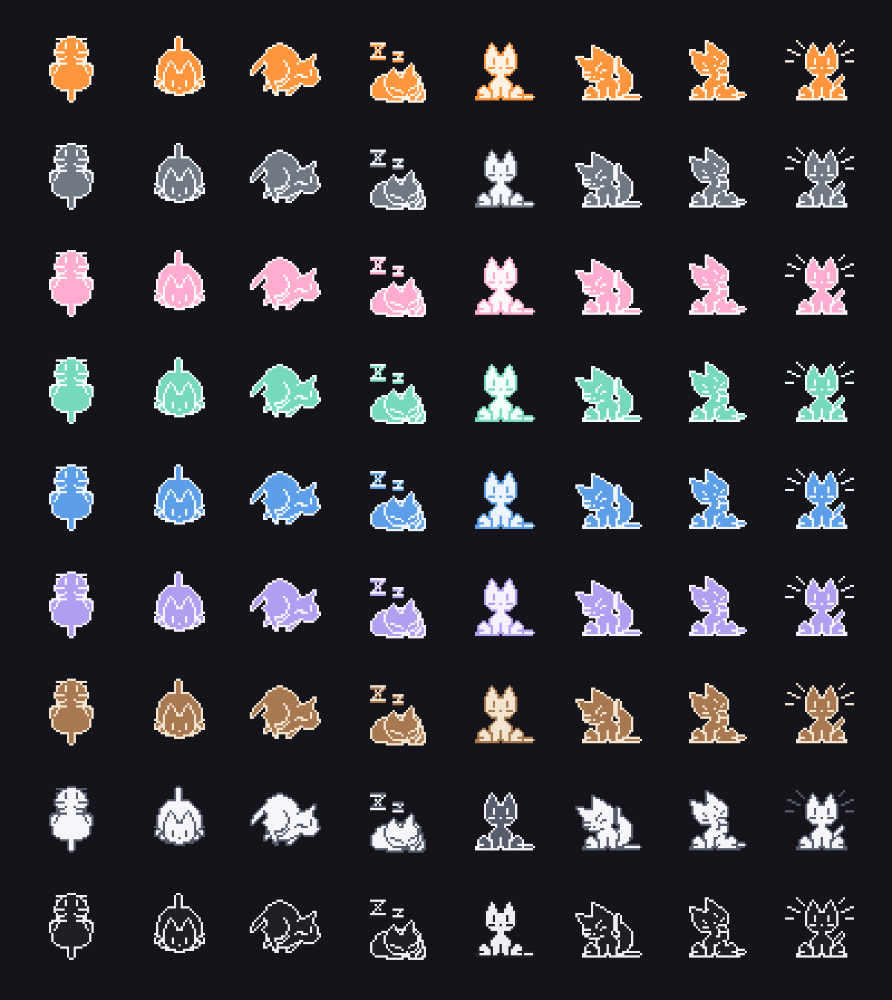

# Gneko

一只住在 Windows 桌面上的像素猫。会自己溜达、跟你玩、追你的鼠标，被拎起来还会被甩飞。

原版：Linux Oneko（1990 年的 X11 桌面猫），这里是用 tkinter + Win32 API 重写的版本。

**简体中文** | [English](README.en.md)


## 特性

- **真透明**：Win32 分层窗口 + 色键（`#ff00ff`），透明区域可穿透点击，不会有白底方块
- **像素锐利**：整数倍最近邻放大 + 进程 DPI 感知，1x–6x 随时切换
- **八方向行走**：`upleft / upright / dwleft / dwright` 素材复用，斜着走也自然
- **自适应帧率**：走路约 24ms 一帧，发呆/睡觉降到 55ms
- **会追人**：距离越远跑得越快（最高 2.6 倍速），贴到光标 16px 内就"抓住"撒欢；鼠标猛甩更兴奋，真不动了才失去兴趣
- **甩飞**：拎起来快速一甩，带惯性飞出去、撞屏幕边缘反弹，落地还摔懵一下
- **多猫联机**：UDP 广播坐标，开两只就会互相追；对方关掉后 2.5s 自动忘掉它
- **不挡手**：穿透点击模式（`Ctrl+Alt+G` 一键切换）
- **可调教**：40+ 项行为参数写在 `Gneko_config.json`
- **9 套预制皮肤**：橘猫、银灰、粉猫、薄荷、天空、香芋、咖啡、雪白、墨黑，右键一键换皮

## 皮肤

`skins/` 下每套皮肤是一份完整素材包（换色后的动作帧 + `mouse.png`），文件名规则和 `Gneko_png` 完全一样。

| 名字 | 中文 | 名字 | 中文 |
| --- | --- | --- | --- |
| `orange` | 橘猫 | `lavender` | 香芋 |
| `gray` | 银灰 | `coffee` | 咖啡 |
| `pink` | 粉猫 | `snow` | 雪白 |
| `mint` | 薄荷 | `black` | 墨黑 |
| `sky` | 天空 | `classic` | 原版黑白（用 `Gneko_png`） |



切换方式（三种任选）：

1. **右键菜单 → 皮肤**，点哪个立刻换，自动写回配置
2. 改 `Gneko_config.json` 里的 `"SKIN": "orange"`，重启生效
3. 命令行临时试：`py -3 Gneko.py --skin snow`

`SKIN` 填 `classic`（或留空）就用 `SPRITE_FOLDER`（默认 `Gneko_png`）里的原版素材；填别的名字则去 `SKINS_DIR/skins/<名字>/` 找素材，目录不存在或没有 PNG 会自动退回原版并打一行警告。

### 自己做一套皮肤

原版像素画只有两个颜色：**纯黑身体 + 白色描边**，所以换肤本质就是换这两色。

```bash
# 1. 编辑 tools/make_skins.py 里的 SKINS 字典，加一行 (中文名, 身体色, 描边色)
# 2. 重新生成全部皮肤
py -3 tools/make_skins.py
```

不想跑脚本也行：复制 `skins/orange` 改成新名字，直接用画图/像素工具改 PNG 保存。文件名规则（`up1`、`dwleft2`、`sleep1`、`utogi`…）保持不变就会被识别；一套皮肤最少只要 `right1/right2` 两帧加一只 `awake` 就能跑，缺的动作会自动回退。

## 下载

不想自己搭环境的话，直接去 [Releases](https://github.com/yizhixiaomei/Gneko/releases) 页面拿打包好的文件：

- `Gneko-vX.Y.Z-source.zip`：完整源码 + 素材 + 九套皮肤
- `Gneko-cursor-pack.zip`：Windows 像素猫光标包（`.cur` / `.ani` + 一键安装脚本）

## 环境要求

- Windows 10 / 11（依赖 Win32 分层窗口、系统光标接口）
- Python 3.9+，带 tkinter
- [Pillow](https://python-pillow.org/)（唯一的第三方依赖）

## 快速开始

```bash
git clone <this-repo> gneko
cd gneko
pip install -r requirements.txt
```

双击 `Gneko.py`，或者：

```bash
pyw -3 Gneko.py          # 无控制台启动（日常推荐）
py -3 Gneko.py           # 带控制台，方便看报错
```

首次启动会自动生成 `Gneko_config.json`，日志写在 `Gneko.log`（`pythonw` 没有控制台，异常都进这里）。这两个文件已经在 `.gitignore` 里。

### 英文版源码

`Gneko_en.py` 是同一份代码的完整英文版：**注释、文档字符串、日志输出、右键菜单、气泡台词、命令行帮助全部是英文**，逻辑与 `Gneko.py` 一模一样（已用 AST 逐节点比对，只差皮肤别名列表里少了个中文别名）。

```bash
py -3 Gneko_en.py             # 英文版
py -3 Gneko_en.py --skin snow # 参数也通用
```

两个文件共用同一个 `Gneko_config.json` 和 `skins/` 目录，换着跑不会互相打架。想维护自己的 fork 时，改完中文版把注释一起翻过去就行——两份代码结构完全一致。

## 操作

| 操作 | 效果 |
| --- | --- |
| 左键拖动 | 把它拎到任意位置，松手后可能贴边磨爪子 |
| 左键甩动 | 松手手速 > 900 px/s 就带惯性飞出去，撞屏幕边缘会弹 |
| 左键双击 | 原地转圈 3 秒 |
| 右键 | 菜单：大小 / 速度 / 皮肤 / 跟随 / 气泡 / 穿透 / 睡觉 / 回鼠标处 / 重载素材 / 退出 |
| 点任意地方 | 提升"兴趣值"，它会更快凑过来 |
| `Ctrl+Alt+G` | 切换穿透点击 |
| `Esc` | 退出 |

> 穿透点击开着的时候点不到猫本身，先用 `Ctrl+Alt+G` 关掉再右键。

改动会写回 `Gneko_config.json`。

## 行为

状态机：`idle / walk / pet / scratch / groom / sleep / play / avoid / sit_approach / sit_cursor / spin_action / flung`

追鼠标分四种性格，每 0.9–2.6 秒才重掷一次（不会每帧乱跳把走位抖成筛子）：

| 子模式 | 行为 |
| --- | --- |
| `chase_normal` | 直线扑向光标 |
| `chase_follow` | 保持 90–140px 尾随 |
| `chase_shy` | 太近会后退（刚抓完一轮或累了才会这样） |
| `chase_pounce` | 兴趣值高时加速猛扑 |

猫有体力：追捕时消耗，发呆/睡觉恢复，低于阈值就懒得追了。

追捕时系统箭头光标会换成 oneko 原版的小老鼠（`Gneko_png/mouse.png`，17×12，热点 8,7）：
用 `CopyIcon` + `SetSystemCursor` 临时替换 `IDC_ARROW`，整个桌面生效但不影响 I 型光标；
猫停下、被拎起或程序退出都会还原。万一被强杀没还原，执行 `py -3 Gneko.py --restore-cursor`。

## 配置

`Gneko_config.json` 缺项自动补默认值，未知项启动时提示并忽略。常用项：

| 键 | 默认 | 说明 |
| --- | --- | --- |
| `SKIN` | `classic` | 皮肤名，见上文「皮肤」；`classic` = 原版素材 |
| `SKINS_DIR` | `skins` | 皮肤根目录，相对路径按程序目录算 |
| `SPRITE_FOLDER` | `Gneko_png` | `classic` 用的原版素材目录 |
| `SCALE` | `2` | 像素放大倍数（2 = 64×64） |
| `BASE_SPEED` | `1.4` | 基础速度 |
| `AUTO_SCALE_HIDPI` | `false` | 按系统 DPI 自动放大 |
| `CHASE_TRIGGER_DIST` | `220` | 多远开始追 |
| `CHASE_MAX_SPEED_MULT` | `2.6` | 追捕最高提速 |
| `CHASE_CATCH_DIST` | `16` | 多近算"抓住" |
| `INTEREST_FLOOR` | `45` | 鼠标在附近时的兴趣值下限 |
| `FLING_MIN_SPEED` | `900` | 甩飞起步手速（px/s） |
| `MOUSE_CURSOR_ENABLE` | `true` | 追捕时换老鼠光标 |
| `CLICK_THROUGH` | `false` | 穿透点击 |
| `ENABLE_MULTICAT_NET` | `true` | 多猫联机（UDP 58231） |

完整列表见 `Gneko.py` 顶部的 `DEFAULT_CONFIG`。

## 命令行

```bash
py -3 Gneko.py --debug            # 打印状态日志
py -3 Gneko.py --scale 3          # 临时 3 倍
py -3 Gneko.py --skin orange      # 临时换成橘猫皮肤
py -3 Gneko.py --list-skins       # 列出所有可用皮肤
py -3 Gneko.py --selftest 10      # 跑 10 秒自动退出（排查用）
py -3 Gneko.py -c other.json      # 指定配置
py -3 Gneko.py --restore-cursor   # 只把系统光标恢复成默认箭头
```

## 项目结构

```
.
├─ Gneko.py             # 全部代码，单文件（中文注释）
├─ Gneko_en.py          # 同一份代码的纯英文版：注释、文档字符串、日志、菜单全英文
├─ Gneko_png/           # 原版 33 帧猫 + mouse.png 光标
├─ skins/               # 9 套预制皮肤，每套一份完整素材包
│  ├─ orange/  gray/  pink/  mint/  sky/
│  └─ lavender/ coffee/ snow/ black/
├─ README.md            # 中文说明
├─ README.en.md         # English version
├─ docs/preview.png     # README 预览图
├─ docs/skins_preview.png  # 皮肤对照图
├─ tools/make_preview.py   # 生成预览图
├─ tools/make_skins.py     # 从 Gneko_png 生成各套皮肤
├─ requirements.txt
└─ LICENSE
```

## 素材

`Gneko_png/` 下 32×32 PNG，按文件名自动归类：

- `up1/up2`、`upleft1/2`、`dwleft1/2` … → 行走（`1/2` 是两帧动画）
- `utogi / dtogi / ltogi / rtogi` → 贴边磨爪
- `kaki1/2` → 舔毛，`sleep1/2` → 睡觉，`jare2` → 玩耍
- `awake`、`mati2`、`mati3` → 发呆，`pet` → 被抚摸
- `mouse.png` → 追捕时的鼠标光标
- `text.png`、`no.png` 这类光标包图标会在加载时跳过，不会当成动作帧

新增素材按同样命名丢进去，右键「重载素材」即可生效。原版 `mati` / `pet` 是白底的，
加载时会自动把**与边缘连通**的白底抠掉（肚子里的白保留），不会露白方块。

## 常见问题

**偶尔显示成白方块？** 说明素材是白底版，已内置自动抠底；非纯白背景不会被处理。

**光标还是老鼠？** 被强杀时来不及还原，执行 `py -3 Gneko.py --restore-cursor`。

**被别的窗口盖住？** 本项目用 `WS_EX_LAYERED | WS_EX_TOOLWINDOW` + `SetWindowPos` 置顶，某些全屏独占游戏会强制覆盖，属正常现象。

**开了两只猫互不理睬？** 检查防火墙是否拦了 UDP 58231。

## AI 生成说明

本项目的代码主体（`Gneko.py` 及 `tools/make_preview.py`）由 AI 辅助生成：由作者提出需求、约束与调试反馈，AI 负责撰写和迭代代码，作者负责在真实 Windows 环境上运行验证、修 bug 和定稿。

需要说明的几点：

- **代码**：AI 生成 + 人工实测修正。所有行为均在 Windows 10/11 实机跑过，但不排除仍存在未覆盖的边界情况。`Gneko_en.py` 是同一份代码的英文翻译版，不是另一套实现
- **素材**：`Gneko_png/` 下的像素猫和 `mouse.png` 全部来自 oneko 原版（public domain），**非 AI 生成**；`skins/` 里的各套皮肤是 `tools/make_skins.py` 对同一批原始像素画做的自动换色，也不是 AI 画的图，版权与署名见下方「致谢」
- **文档**：本 README 与 `README.en.md` 由 AI 起草，经作者核对后提交
- **许可证**：代码采用 MIT，可自由使用、修改、再发布；若你二次分发，建议保留本节说明

如果你在 fork 或改造后遇到问题，欢迎在 Issues 里反馈。

## 致谢

- 猫素材来自 oneko（Tatsuya Kato 1990 年的 X11 版本；猫图由 Juan Gotoh 绘制，Masayuki Koba 转成 X11 位图）。Debian 的版权文件将其列为 public domain
- 老鼠光标取自 oneko 的 `mouse_cursor.xbm`（17×12，热点 8,7）

## 许可

代码 MIT，详见 [LICENSE](LICENSE)；素材署名与授权见上文「致谢」。
